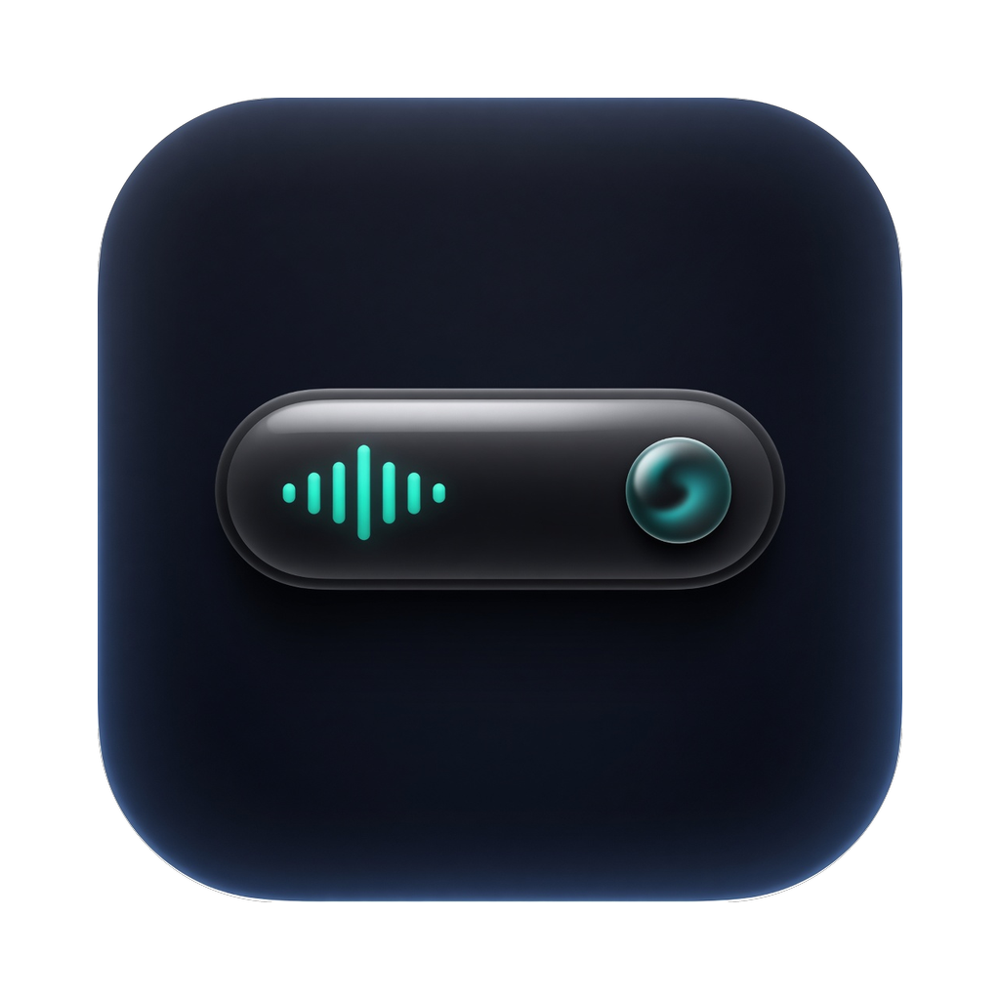
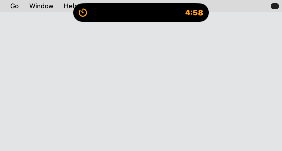
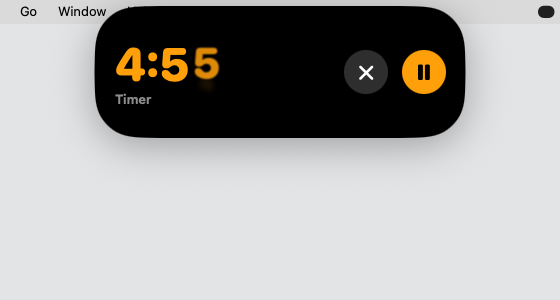

<p align="center"></p>

# Atoll

A software Dynamic Island for **any** Mac display — made for a Mac mini on a monitor with no notch. Native Swift + SwiftUI, Apple's own Live Activity layouts (compact, minimal, expanded) and spring motion.

<p align="center"> </p>
<p align="center"><sub>Real captures from the macOS CI runner (<code>--demo</code>): compact timer, then the bloom into expanded.</sub></p>

## Features
- **Now Playing from any app** — Music, Spotify, Safari/Chrome video, YouTube, VLC… Artwork, title/artist, live waveform tinted by the artwork, scrubber, previous / play-pause / next.
- **Timer** — 1/5/10/25 min presets or custom, countdown with numeric roll, pause/cancel, blooms when done.
- **Volume & brightness HUD** in the island (optional; shown alongside the system OSD).
- **Battery / charging** — plug-in bloom and low-battery alert (quietly off on a Mac mini).
- **Calendar** — next event within the hour, with a Join button for Meet/Zoom/Teams links.
- **Shelf** — drag files onto the island to park them; drag them back out or AirDrop them.
- **Up to three activities** at once, iPhone 18 Pro style: one compact, the rest as detached bubbles.
- **Settings** — display picker, Classic or Small (iPhone 18 Pro) pill, size, X/Y offset, hover vs click, hover delay, per-activity toggles, pure black or glass, reduce motion, hide idle pill, haptics, launch at login.
- Menu bar app, no Dock icon.

## Install
1. Download `Atoll.zip` from the latest [release](https://github.com/max-pantom/atoll/releases) (or the `Atoll-app` artifact of the latest [build](https://github.com/max-pantom/atoll/actions)).
2. Unzip and move `Atoll.app` to `/Applications`.
3. The app is ad-hoc signed, not notarized. Either right-click → **Open** the first time, or run:
   ```sh
   xattr -dr com.apple.quarantine /Applications/Atoll.app && open /Applications/Atoll.app
   ```
4. The island appears at the top centre of your main display. Use the menu bar icon → **Settings…** to pick a display and tune it.

Requires macOS 14 Sonoma or later (Apple Silicon or Intel).

## Build from source (no Xcode project)
```sh
scripts/fetch-mediaremote.sh   # optional: Now Playing helper for macOS 15.4+ (needs cmake)
scripts/bundle.sh 0.1.0        # -> dist/Atoll.app
```

## How Now Playing works
Since macOS 15.4 Apple only lets `com.apple.*` processes read the system Now Playing info. Atoll bundles [ungive/mediaremote-adapter](https://github.com/ungive/mediaremote-adapter) (BSD-3), which runs inside Apple's `/usr/bin/perl`. On older macOS it calls MediaRemote directly, and it falls back to AppleScript for Music and Spotify. A future macOS update could break the helper.

## Design notes
Sizes, corner radii, states and motion come from Apple's HIG and WWDC23 "Design dynamic Live Activities"; Apple never published the exact springs, so the values are tuned estimates. See [plans/RESEARCH.md](plans/RESEARCH.md) and [plans/SPEC.md](plans/SPEC.md).
